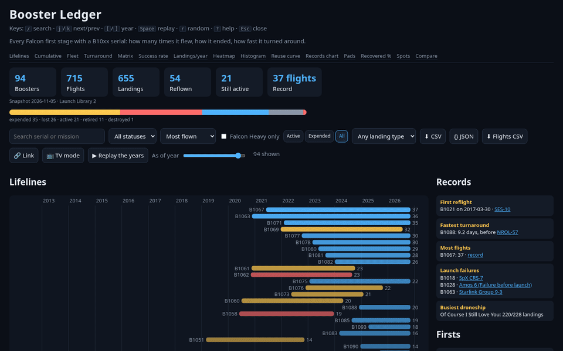
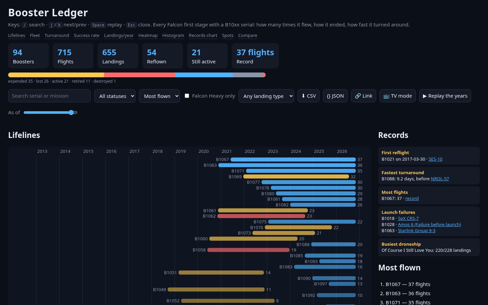

# Booster Ledger

Every Falcon first stage with a B10xx serial on one screen: how many times it flew, how it ended, how fast it turned around, and where it landed.





## What's on the screen
- **Lifelines:** one bar per booster, from its first flight to its last. Blue is active, gold expended, red lost or destroyed, and the number is its flight count. Sort by most flown, first flight or newest; filter by status, Falcon Heavy, or landing type (ASDS / RTLS / Ocean / expended); search by serial or mission name.
- **As-of scrubber + Replay the years** (Space): drag the year slider or press Replay to watch the fleet grow. Stats, bars and leaderboards update as of each year. The year is shareable in the URL (`?y=2021`).
- **Booster drawer** (click a bar, press `j`/`k`, or open `#B1067`): every flight with its mission, date, landing spot and source link; a mission timeline; days-between sparkline; landing breakdown; rank, block version and landing rate. Launch failures and Falcon Heavy flights are tagged.
- **Records:** first reflight, fastest turnaround, most flights, every launch failure, and the busiest droneship. Each one links its source.
- **Active fleet over time:** how many boosters had flown by each year-end and were still flying, plus a Block 5 / Full Thrust / v1.0 legend.
- **Turnaround trend:** median and fastest days between reflights, by year.
- **Landing success rate by year.**
- **Flights per year** split by how the booster came home (droneship, back to land, ocean or expended).
- **Flights per month** heatmap and **turnaround distribution** histogram.
- **Reuse record progression:** the first booster to reach each flight count.
- **Landing spots** and **launch pads and rockets** tables.
- **Compare two boosters:** cumulative-flights chart and a side-by-side table.
- **Link** copies a URL with the current filters, landing type, as-of year and comparison. **CSV** and **JSON** download the boosters shown.
- **TV mode** (`?mode=tv`, optional `&every=8000`): big-type cards that cycle through the 10 most-flown boosters. Arrow keys step; Esc exits.
- **On-this-page** jump links skip the long lifelines list straight to the charts.

## Data
Public data only, from [The Space Devs Launch Library 2 API](https://thespacedevs.com/llapi). Both snapshots are committed in `src/` with their fetch times, and every booster and flight links its LL2 record. See [docs/DATA.md](docs/DATA.md) for fields, caveats (AMOS-6 counts as a flight) and how block version is derived. `validate.mjs` checks that the two snapshots agree for every booster, and `npm run refresh` refuses to save a pull that fails those checks. This project isn't affiliated with SpaceX. The server only serves files from `src/`, and the page makes no outside requests at runtime.

## Run (2 minutes)
```
npm i
npm start                        # http://127.0.0.1:4477
npm test                         # unit + data-consistency tests
npx playwright test              # browser tests: features, DOM numbers vs raw JSON, a11y (axe), security
npm run refresh                  # re-pull both snapshots (~10 requests; anonymous LL2 allows ~15/hour)
npm run mutation                 # kill ledger/charts/app/server mutants
node shots.mjs                   # refresh screenshots/ + demo.gif (server must be up)
```

## Layout
`src/ledger.js` holds pure data functions, `src/charts.js` pure SVG builders, `src/app.js` the DOM wiring and `server.js` a static server for `src/` only. `scripts-flights.mjs` derives `flights.json` from the raw API pages, and `validate.mjs` does the cross-checks. Tests live in `test/` (vitest) and `e2e/` (Playwright). See [docs/ADVERSARIAL.md](docs/ADVERSARIAL.md) for the latest review notes.

## Keys
`/` search · `j` / `k` next / previous booster · `Space` replay · `Esc` close
